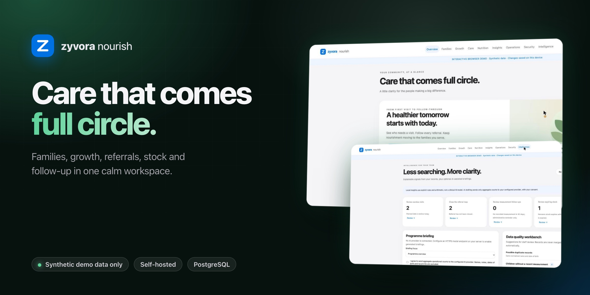
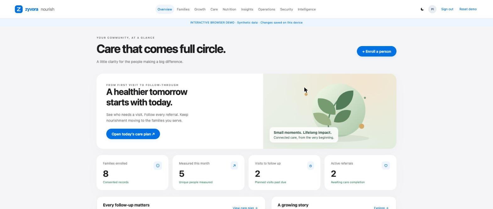
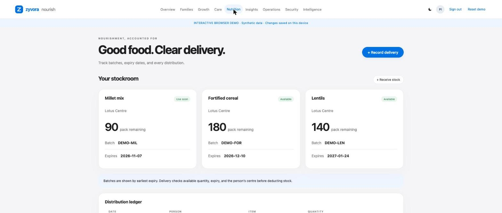
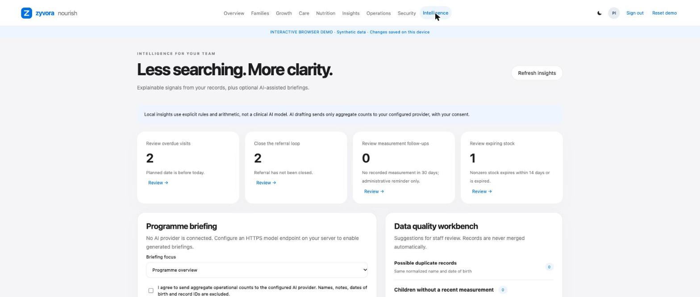
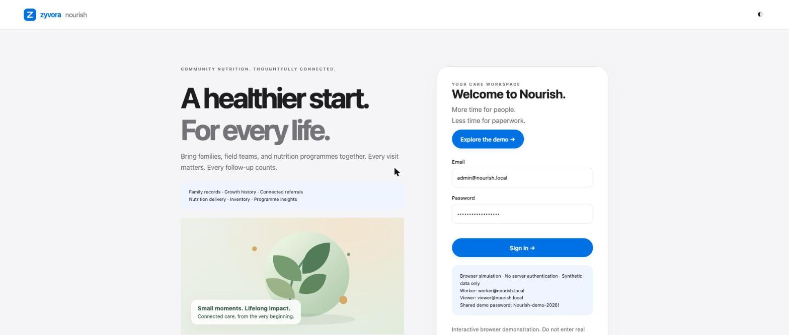

# Zyvora Nourish

**A healthier start. For every life.**

Public website for Zyvora Nourish: community nutrition and field operations in one self-hosted workspace. **Synthetic data only.** The application source is private; this repository holds website content only.

## Live demo

**[zyvorai.github.io/zyvor-nourish-site/demo/](https://zyvorai.github.io/zyvor-nourish-site/demo/)**

The demo is a browser-local simulation of the same interface. It runs entirely on your device, stores changes in your browser, and has no server, real sign-in or database. Choose **Explore the demo**. Never enter real personal or health information.

## What it covers

| Area | In the product |
|---|---|
| Families | Consent-based enrolment, search, centres, profile history |
| Growth | Dated measurements and history charts, no invented growth standards |
| Care | Visits, overdue queues, referrals closed only with an outcome |
| Nutrition | Batches by expiry, checked deliveries, corrections with reasons |
| Operations | Appointments, attendance, tasks, meal plans, immunisations, counselling, equipment |
| Insights | Explained follow-up rules, duplicate review, stock-days estimates, optional AI briefings (aggregate counts only, with consent) |
| Security | Three roles, tenant scoping, expiring sessions, audit trail |
| Reporting | Live counts, CSV summary, versioned JSON export |

## Screens

| | |
|---|---|
|  |  |
|  |  |

## Honest limits

- **Synthetic data only.** All people and stock in the demo are invented.
- **Not a clinical system.** Insights use plain rules and arithmetic; no clinical, privacy or compliance certification is claimed.
- **AI is optional** and was exercised only with a test double; no model accuracy or latency claim is made.
- **Independent product.** Not affiliated with Poshan Tracker or any government system.
- The application source is private; this site carries no product code.

## Contact

sales@zyvor.dev · security@zyvor.dev

© 2026 Zyvor AI Labs
